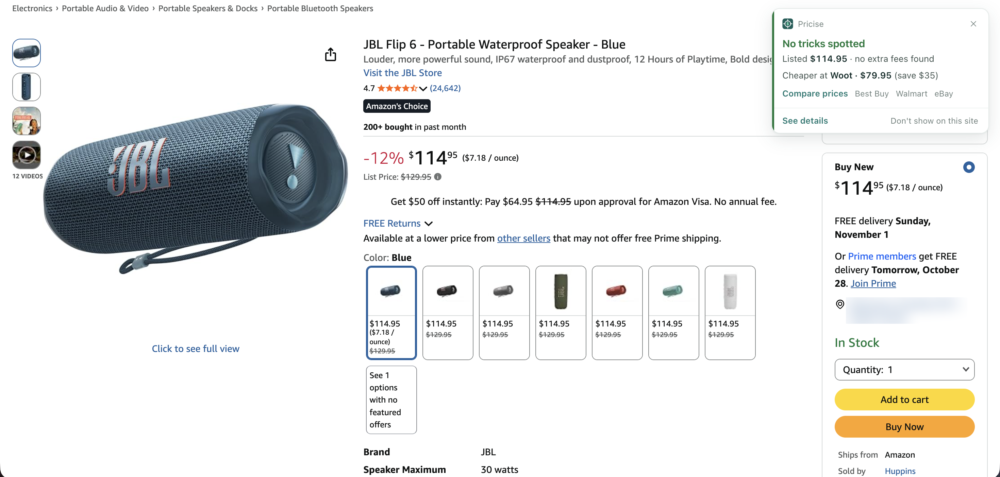
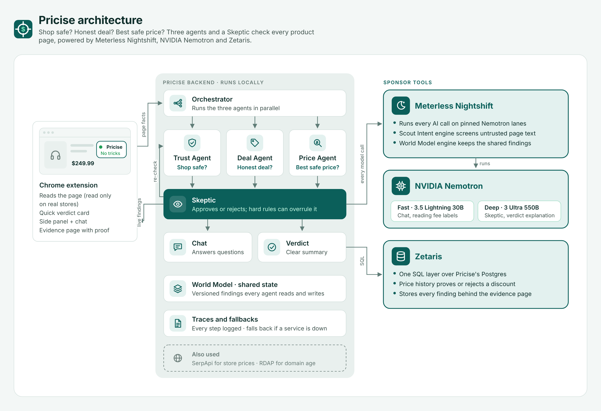
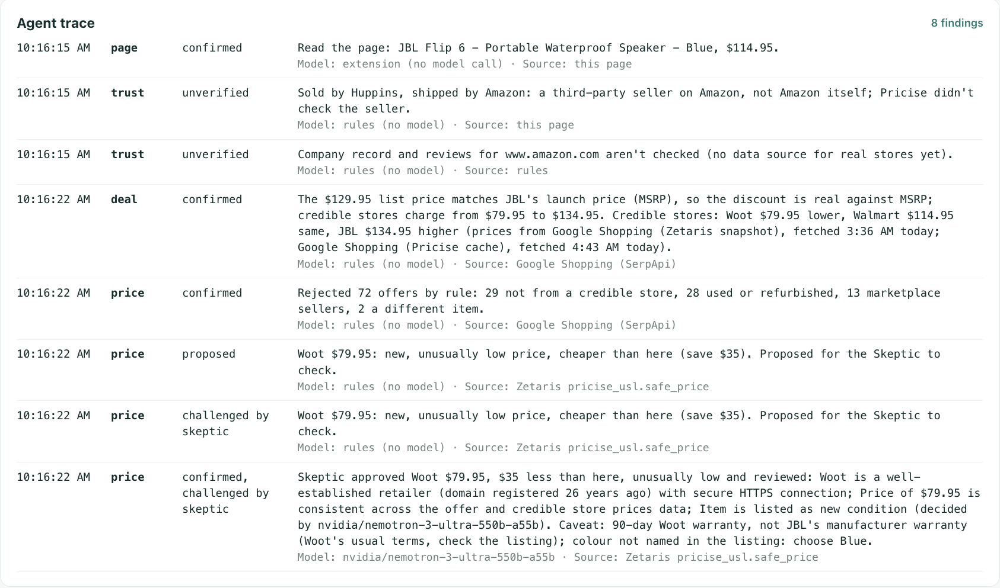
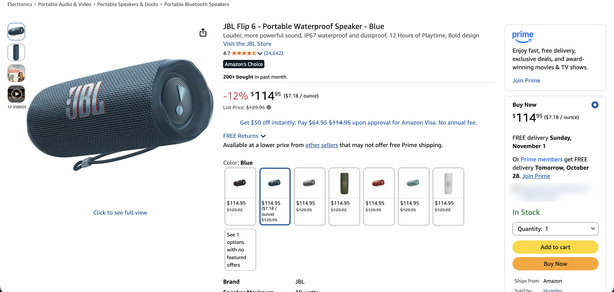
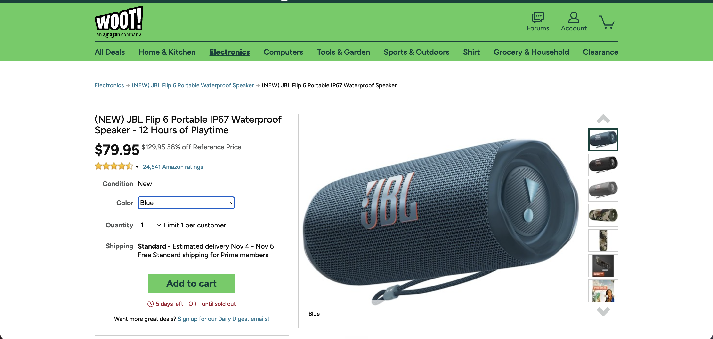
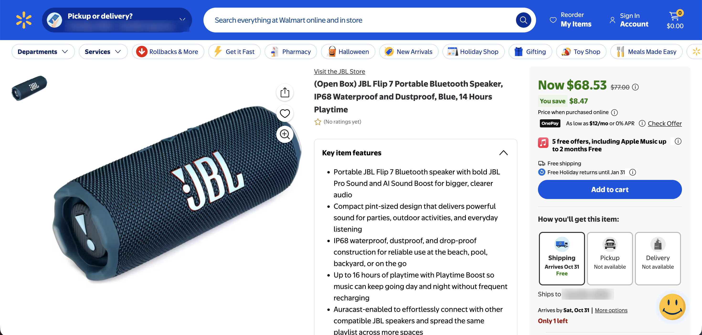
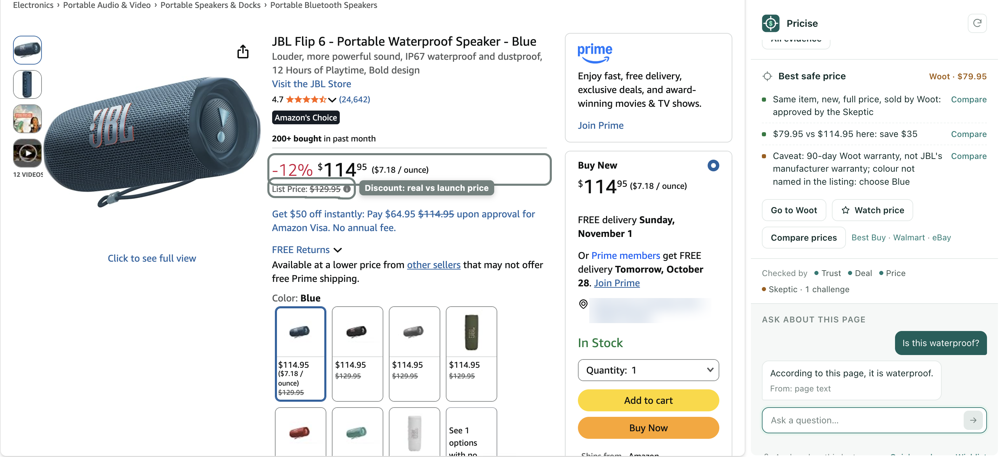
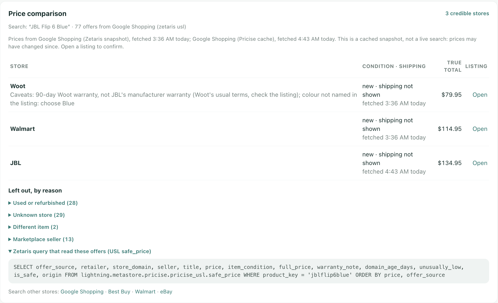

# Pricise

**Shop safe? Honest deal? Best safe price? Agents that check each other before you buy.**

Track: Reasoning Architecture · Team XLR8 · Demo video: TBD



Online shoppers face fake "was" prices, countdowns that restart, and the same item cheaper at a store they would trust.
Pricise is for an everyday shopper standing on a product page, about to click Buy. It is a Chrome extension: three agents
check the store, the deal and the price; a Skeptic agent challenges their findings; every claim links to its proof.

## For judges: where to find each requirement

| Requirement | Where |
|---|---|
| Demo video | TBD |
| Slide deck | TBD |
| Setup | [Run it in 2 minutes](#run-it-in-2-minutes-sample-mode) · [Run it for real](#run-it-for-real) |
| Usage + sample inputs and outputs (3 real pages, 1 synthetic) | [Run it in 2 minutes](#run-it-in-2-minutes-sample-mode) · [input_examples/](input_examples/) · [output_examples/](output_examples/) |
| Dependencies | [backend/requirements.txt](backend/requirements.txt) · [engine sidecar package.json](backend/engines/world_model_ts/package.json) |
| Agent traces | [output_examples/example_1_trace.jsonl](output_examples/example_1_trace.jsonl) (every run writes `logs/<check_id>.jsonl`) |
| Meterless engine tests | [test_scout_guard.py](backend/tests/test_scout_guard.py) · [test_scout_sidecar.py](backend/tests/test_scout_sidecar.py) · [test_world_model_dedupe.py](backend/tests/test_world_model_dedupe.py) · [test_orchestrator.py](backend/tests/test_orchestrator.py) · [screenshot](docs/images/13-engine-tests.png) |
| Nightshift connection | [backend/llm/meterless.py](backend/llm/meterless.py) (the only file that calls a model) |
| Nemotron models used | [Sponsor technology: NVIDIA](#nvidia-nemotron) |
| Zetaris USL | [docs/zetaris/USL.md](docs/zetaris/USL.md) · [docs/zetaris/pricise_usl.sql](docs/zetaris/pricise_usl.sql) |
| Zetaris reflection | [docs/zetaris/REFLECTION.md](docs/zetaris/REFLECTION.md) |
| Sponsor explanation | [docs/SPONSORS.md](docs/SPONSORS.md) |
| `.env.example` | [.env.example](.env.example) |
| `SAMPLE_MODE` | [Run it in 2 minutes](#run-it-in-2-minutes-sample-mode) · [backend/recordings.py](backend/recordings.py) |
| Pre-existing work | [Pre-existing components](#pre-existing-components) |

| Judging criterion | What shows it |
|---|---|
| Impact | [The problem, in screenshots](#screenshots) |
| Technical | [Architecture](#architecture) · [Failure handling](#failure-handling) |
| Innovation | [How the agents check each other](#how-the-agents-check-each-other) |
| Demo | [docs/DEMO_SCRIPT.md](docs/DEMO_SCRIPT.md) · Demo video: TBD |
| Product & UX | [Screenshots](#screenshots) |
| Sponsor Tech | [Sponsor technology](#sponsor-technology) · [docs/SPONSORS.md](docs/SPONSORS.md) |

## Run it in 2 minutes (sample mode)

No keys, no Docker, no services. You need Python 3.11+ and Git. Sample mode replays a recorded real run: no call to
Zetaris, Nightshift, SerpApi or any store.

```bash
git clone <repo-url> pricise && cd pricise
scripts/setup.sh                 # .venv, Python packages, .env from .env.example (SAMPLE_MODE=true)
.venv/bin/python run.py          # example 1: JBL Flip 6, Blue, on amazon.com
```

Expected output (the check ID differs per run):

```
Backend http://localhost:8787 · mode: sample · deal=stub trust=stub price=stub orch=off data=fixture (started for this run)

VERDICT  No tricks spotted · 0 tricks · 0 claims to check · recorded from a real run on 27 Oct 2026  (1.1s)
  Shop safe?        Looks safe
  Honest deal?      Looks honest
  Best safe price   Woot · $79.95
  Better option     Woot · $79.95

Agent trace: logs/<check_id>.jsonl (8 finding events)
```

`setup.sh` also downloads Playwright's Chromium and, with Node 20+, the engine sidecar's packages; sample mode needs
neither. Windows: `scripts\setup.ps1`, then `.venv\Scripts\python run.py`. `run.py` starts the backend for the run and
stops it afterwards.

**The examples.** Inputs 1-3 are what the extension read from real product pages in Chrome. Input 4 is AudioDealz, a
fake store we built for testing (`storelab/`), run with the real agents: "Don't buy here", 3 tricks, real total $191.

| # | Page | Input | Output and trace |
|---|---|---|---|
| 1 | JBL Flip 6, Blue, amazon.com, $114.95 | [example_1.json](input_examples/example_1.json) | [result](output_examples/example_1_result.json) · [trace](output_examples/example_1_trace.jsonl) |
| 2 | Kindle Paperwhite 16GB (2024), amazon.com, $199.99 | [example_2.json](input_examples/example_2.json) | [result](output_examples/example_2_result.json) · [trace](output_examples/example_2_trace.jsonl) |
| 3 | Open-box JBL Flip 7, Blue, walmart.com, $68.53 | [example_3.json](input_examples/example_3.json) | [result](output_examples/example_3_result.json) · [trace](output_examples/example_3_trace.jsonl) |
| 4 | Synthetic test store (made up by us): shows the red verdict | [example_4.json](input_examples/example_4.json) | [result](output_examples/example_4_result.json) · [trace](output_examples/example_4_trace.jsonl) |

`.venv/bin/python run.py --input input_examples/example_2.json` runs another input (2, 3 or 4). All four replay their
recorded run in sample mode (`samples/`); any other page gets a scripted result.

**See it in Chrome:** `scripts/run.sh` (backend on :8787) → `chrome://extensions` → Developer mode → **Load unpacked** →
the `extension/` folder → open https://www.amazon.com/dp/B09GJZKQ3K and click the Pricise icon for the side panel.

## Run it for real

Full mode runs every agent live. Copy `.env.example` to `.env` (setup does this), set `SAMPLE_MODE=false` and fill in:

| Service | `.env` keys | Notes |
|---|---|---|
| Meterless Nightshift | `METERLESS_BASE_URL`, `METERLESS_RUNTIME_TOKEN`, `NEMOTRON_FAST_MODEL`, `NEMOTRON_DEEP_MODEL` | Judge lane: `nvidia/nemotron-3-ultra-550b-a55b` (deep). Verify lane: `nvidia/nemotron-3.5-lightning-30b-a3b` (fast). The NVIDIA key lives in Nightshift, not in `.env` |
| Zetaris | `ZETARIS_REST_URL`, `ZETARIS_API_KEY`, `ZETARIS_ORG_ID` | Lightning SQL over REST |
| Pricise Postgres | `PRICISE_PG_*` | Docker, port 5433 |
| SerpApi (Google Shopping) | `SERPAPI_KEY` | Optional; without it the online comparison is skipped |

```bash
.venv/bin/python scripts/check_zetaris.py                            # Zetaris answers?
docker compose -f docker-compose.pricise.yml --env-file .env up -d   # Pricise Postgres
.venv/bin/python scripts/seed.py                                     # create the tables
.venv/bin/python scripts/register_zetaris.py --yes                   # register Postgres in Zetaris as pricise_pg
.venv/bin/python scripts/zetaris_usl.py show                         # the USL setup statements, key masked
.venv/bin/python scripts/zetaris_usl.py run 1 22                     # create the sources, the USL and the DQ rule
scripts/run.sh --real                                                # every agent live, orchestrator on
```

Then load the extension (above) and open https://www.amazon.com/dp/B09GJZKQ3K. `curl -s localhost:8787/health` shows
the mode. Tests: `scripts/test.sh` (offline, no live calls when the keys are blank).

## Architecture



| Agent | Job | Model or rules | Can block? Retries? |
|---|---|---|---|
| Orchestrator ([orchestrator.py](backend/orchestrator.py)) | Runs the agents in parallel, streams findings, sends them to the Skeptic, writes the trace | Rules | Stops a page that isn't a product page. A failed or slow agent (60 s) becomes one "unverified" finding; the rest go on |
| Trust Agent ([trust.py](backend/agents/trust.py)) | Is the store safe? HTTPS, domain age (public RDAP), contact and returns links, who sells the item | Rules decide; Nemotron Lightning rewords the reasons | Yes: an unsafe store can't be a best price. An unreachable store is "couldn't check", never "safe" |
| Deal Agent ([deal.py](backend/agents/deal.py)) | Is the deal honest? Fake discounts, resetting timers, pre-ticked add-ons, late fees | Rules (Lightning reads fee labels on test pages) | No, it reports. Each tool has a time limit; a failed tool says what it couldn't check |
| Price Agent ([price.py](backend/agents/price.py)) | Same item cheaper at a credible store? Reads Zetaris `safe_price`, classifies every offer | Rules | No, it proposes cheaper offers to the Skeptic. Zetaris fails → its own Google Shopping search |
| Skeptic ([skeptic.py](backend/agents/skeptic.py)) | Challenges findings before the shopper sees them | Hard rules; Nemotron Ultra decides "unusually low" offers | Yes: rejects proposals. Up to 2 rounds |
| Chat ([chat.py](backend/agents/chat.py)) | Answers the shopper's questions from the page | Nemotron Lightning | No. Untrusted page text is screened by Scout first |

## How the agents check each other

On the demo page (JBL Flip 6, $114.95 on Amazon), the Price Agent found Woot selling it new for $79.95, well under the
other credible stores ($114.95 to $134.95). That is unusually low, so it is a proposal, not an answer:

1. **Price Agent proposes:** "Woot $79.95: new, unusually low price, cheaper than here (save $35). Proposed for the Skeptic to check."
2. **Skeptic challenges.** Hard rules first: same model and colour, new, full price, sold by the retailer itself, store
   passed the Trust Agent. Any failure rejects, whatever a model says.
3. **Nemotron Ultra decides** the borderline call and gives reasons and caveats.
4. **Result:** approved, with the caveat "90-day Woot warranty, not JBL's manufacturer warranty". In the same run the rules
   rejected 72 offers: 29 not from a credible store, 28 used or refurbished, 13 marketplace sellers, 2 a different item.



If Nightshift is unavailable, the rules decide and the trace says "decided by rules (model unavailable)".

## Sponsor technology

### Zetaris

Three sources (Pricise's Postgres, public RDAP domain records, a Google Shopping search) joined in one Unified Semantic
Layer, `pricise_usl`. Its `safe_price` table answers "cheapest" and "safe" in one query, and the Price Agent reads it.
A data-quality rule, `new_full_price`, flags offers that aren't new or aren't a full price.
Proof: [safe_price query](docs/images/10-zetaris-safe-price-query.png) · [DQ rule results](docs/images/11-zetaris-dq-invalid.png) ·
[USL.md](docs/zetaris/USL.md) · [REFLECTION.md](docs/zetaris/REFLECTION.md).

### Meterless

Nightshift is the only AI provider: every model call goes through [backend/llm/meterless.py](backend/llm/meterless.py),
with models pinned by name. Two Meterless engines run in the product: **Scout Intent** screens untrusted page text
before every model call, and **World Model** is the shared store of findings during a check.
Proof: [Nightshift lanes](docs/images/04-nightshift-lanes.png) · [engine tests](docs/images/13-engine-tests.png).

### NVIDIA Nemotron

**Nemotron 3 Ultra 550B** (`nvidia/nemotron-3-ultra-550b-a55b`, Judge lane) is the Skeptic's judge for unusually low
offers. **Nemotron 3.5 Lightning 30B** (`nvidia/nemotron-3.5-lightning-30b-a3b`, Verify lane) answers chat and rewords
reasons. The trace names the model behind every step, or "rules".
Proof: [Nightshift providers](docs/images/05-nightshift-providers.png) · [Nightshift lanes](docs/images/04-nightshift-lanes.png).

**Cursor:** Raj and Abel built the Trust Agent, the orchestrator and the Nemotron connection in Cursor.

More detail: [docs/SPONSORS.md](docs/SPONSORS.md).

## Screenshots

**The problem.** The same speaker: $114.95 on Amazon with a "List Price" discount, $79.95 new at Woot, and a cheaper
"Blue" offer at Walmart that is really an open-box Flip 7.

| Amazon | Woot | Walmart |
|---|---|---|
|  |  |  |

**The product.** The side panel's verdict, with the discount claim outlined on the page, and the evidence page's price comparison.

| Side panel | Evidence page |
|---|---|
|  |  |

## Failure handling

| What fails | What Pricise does |
|---|---|
| An agent errors or is too slow | It becomes one "unverified" finding; the check carries on |
| Zetaris doesn't answer (15 s) | The Price Agent runs its own Google Shopping search; the evidence page says why |
| Nightshift not configured or failing | Rules decide and say so; chat and wording use the rule text |
| SerpApi missing or failing | The online comparison is skipped, or one "couldn't search" row |
| RDAP failing | Domain age "couldn't check"; the store is never called safe on missing data |
| Engine sidecar down | World Model and Scout fall back to local behaviour, with one warning |
| Not a product page | "Not a product page", before any agent, search or model call |
| Hidden instructions in page text | Scout drops them before any model reads the text |

## Limitations

- The MSRP (launch price) check only knows the products listed in [backend/data/msrp.py](backend/data/msrp.py). For
  others, a list price is compared with credible stores' prices only.
- The Zetaris Google Shopping source is a cached snapshot, not a live search. Pages say when its prices were fetched.
- On real stores Pricise is read only: it never clicks, adds to cart or buys, and never loads other stores' sites.
- Store checks on real sites cover HTTPS, domain age and page links; company records and reviews aren't checked.
- The online comparison covers allowlisted retailers only and depends on what Google Shopping returns.
- The timer test and checkout run-ahead only run on the local test pages.

## Data

- Real store pages are read only, in the shopper's own Chrome. Saved price observations keep product fields and the URL
  without its query string; nothing personal.
- Store Lab (`storelab/`) holds synthetic test stores made up by us, used by the tests and by example 4. No real shop.

## Team

| Name | Role |
|---|---|
| Shriganesh Sivakumar | Product lead: extension, Deal and Price agents, integration |
| Raj | Trust Agent (Cursor) |
| Abel | Orchestrator, Skeptic, Meterless engines, Nemotron connection (Cursor) |
| Josh | Presentation |
| Emmanuel | Presentation |

## Pre-existing components

None: all code was written during the build window (from 23 October 2026).

Third-party open-source code used as is: the Meterless reference engines in
[backend/engines/world_model_ts/](backend/engines/world_model_ts/) (Apache-2.0, see its LICENSE and NOTICE), and Python
and Node packages listed in the dependency files.
