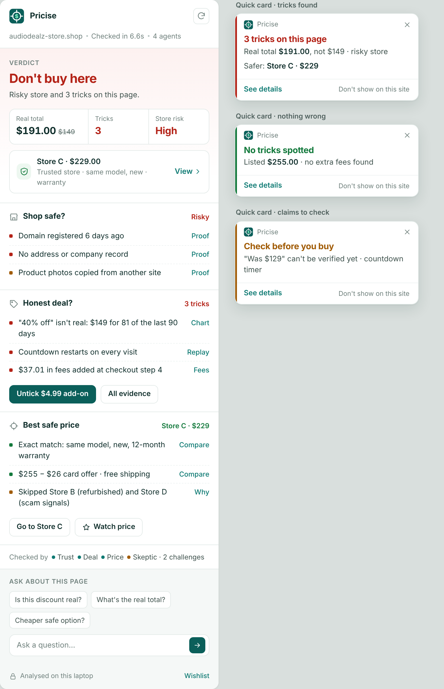

# Pricise

**Shop safe? Honest deal? Best safe price?** Pricise is a Chrome extension that checks a product page before you buy. It reads
the page you're on, catches tricks (fake discounts, countdowns that reset, pre-ticked add-ons, fees added late in checkout),
checks the store, and finds the exact same item at a trusted store. Four agents (Trust, Deal, Price, Skeptic) check each other's
work, every claim links to its proof, nothing is bought without your approval, and your data stays on your laptop.
Built for the Open Agent Hackathon 2026 (Track 3: Reasoning Architecture) with Cursor, Zetaris, Meterless Nightshift and
NVIDIA Nemotron.



## Quickstart

You need **Python 3.11+**, **Git** and **Google Chrome**.

```bash
git clone <repo-url> pricise && cd pricise
scripts/setup.sh          # .venv, packages, Playwright's Chromium, .env      (Windows: see below)
scripts/run.sh            # backend on http://localhost:8787, scripted demo agents
```

On Windows (PowerShell):

```powershell
powershell -ExecutionPolicy Bypass -File scripts\setup.ps1
powershell -ExecutionPolicy Bypass -File scripts\run.ps1
```

Then in Chrome:

1. Open `chrome://extensions`, turn on **Developer mode** (top right), click **Load unpacked** and pick the `extension/` folder.
2. Pin Pricise: puzzle-piece icon in the toolbar, then the pin next to Pricise.
3. Open http://localhost:8787/storelab/audiodealz/: a red quick card appears ("3 tricks on this page"). Click the Pricise icon
   for the side panel; red outlines mark the tricks on the page.
4. Try **Untick $4.99 add-on**, **All evidence**, **Go to Store C**, **Watch price**, ask a question in the chat, then
   **Wishlist** (footer) → **Day 9** for the desktop notification.

Run the tests any time with `scripts/test.sh` (Windows: `scripts\test.ps1`).

## Switches

Set them in `.env` (created by setup from `.env.example`) or in your shell; the shell wins. With no `.env` at all everything
runs in stub mode.

| Variable | Values | What it does |
|---|---|---|
| `AGENT_DEAL` | `stub` (default) · `real` | `real` runs the Deal Agent (`backend/agents/deal.py`) instead of the scripted deal findings. Shortcut: `scripts/run.sh --real` |
| `SAMPLE_MODE` | `true` (default) · `false` | Demo-friendly timings for the Store Lab tools |
| `TIMER_GAP_S` | seconds, default `3` in sample mode | Gap between the timer test's 3 fresh page loads |
| `AGENT_PRICE` | `stub` (default) · `real` | `real` runs the Price Agent (`backend/agents/price.py`): best safe price from the Store Lab catalog, following the demo clock |
| `DATA_SOURCE` | `fixture` (default) · `zetaris` | `zetaris` reads price history, listings and the wishlist through Zetaris and stores findings; falls back to the fixture if Zetaris fails |
| `PLAYWRIGHT_CHROMIUM_PATH` | path, optional | Use this Chromium for the hidden browser |
| `METERLESS_*`, `NEMOTRON_*` | see `.env.example` | Model calls through Meterless Nightshift. Unset = rule-based answers, everything still works |

More agents follow the same pattern as they land (`AGENT_TRUST`, `AGENT_PRICE`, …): stub first, swapped to real one at a time.

## Project structure

```
extension/   Chrome extension (side panel, quick card, content script, evidence + wishlist pages)   README inside
backend/     FastAPI backend: API, agents, tools, model client, data access, tests                README inside
storelab/    Made-up stores for the demo (AudioDealz hero, Store C, a generic checkout)          README inside
bench/       Labelled test pages + accuracy runner                                               README inside
docs/        Plan, mockups (current: docs/mockups/ui-v2/), kickoff prompts                       README inside
scripts/     setup / run / test for macOS and Windows                                            README inside
AGENTS.md    Rules every coding agent (and person) follows: contracts, secrets, real-site safety
```

## Team and ownership

| Person | Part | Paths |
|---|---|---|
| Shriganesh | Product lead, extension UI, demo, repo | `extension/`, `storelab/audiodealz/`, `README.md`, `scripts/` |
| Raj | Trust Agent | `backend/agents/trust.py` |
| Emmanuel | Deal Agent | `backend/agents/deal.py`, `backend/tools/` |
| Josh | Price Agent, Store Lab, Zetaris | `backend/agents/price.py`, `storelab/` stores A–I, `backend/data/` |
| Abel | Orchestrator, Skeptic, Meterless + Nemotron | `backend/orchestrator.py`, `backend/agents/skeptic.py`, `backend/llm/meterless.py`, `backend/contracts.py` |

How to contribute: see [CONTRIBUTING.md](CONTRIBUTING.md).

## Using real Zetaris / Meterless

Everything runs without keys today. When you plug in a real service, put its values in your own `.env` (never commit it):

- **Meterless Nightshift (Abel).** Fill in `METERLESS_BASE_URL`, `METERLESS_RUNTIME_TOKEN`, `NEMOTRON_FAST_MODEL`,
  `NEMOTRON_DEEP_MODEL`. All model calls go through `backend/llm/meterless.py` (`complete(prompt, lane="fast"|"deep")`); it
  returns `""` when unconfigured and callers fall back to rules. Abel replaces the minimal client with the full one (engines in
  `backend/engines/`).
- **Zetaris (Josh).** Fill in `ZETARIS_REST_URL`, `ZETARIS_API_KEY`, `ZETARIS_ORG_ID` and the `PRICISE_PG_*` values (start the
  Zetaris Docker first). Zetaris can't read files on your laptop, so Pricise data lives in its own Postgres that Zetaris queries:
  ```bash
  .venv/bin/python scripts/check_zetaris.py                               # SELECT 1 + SHOW LIGHTNING DATABASES
  docker compose -f docker-compose.pricise.yml --env-file .env up -d      # Pricise Postgres on 127.0.0.1:5433
  .venv/bin/python scripts/seed.py                                        # synthetic Store Lab data
  .venv/bin/python scripts/register_zetaris.py                            # dry run; add --yes to register pricise_pg
  ```
  Then set `DATA_SOURCE=zetaris` (and `AGENT_PRICE=real`). Reads go through Zetaris REST; writes (wishlist, findings) go
  straight to the Pricise Postgres, because Zetaris can't UPDATE a JDBC datasource and its INSERT ignores column defaults.
- **Trust Agent (Raj), Price Agent (Josh), orchestrator + Skeptic (Abel).** Implement your agent, add an `AGENT_<NAME>=real`
  switch in `backend/stub_server.py` (or the orchestrator) the way `AGENT_DEAL` works, keep the Finding / FinalCard shapes from
  `backend/contracts.py`, and keep `stub` the default so the demo never breaks.

## Safety rules

- **Real store pages are read only.** The extension reads the page you are looking at; it never clicks, submits or buys. The
  only page change is unticking an add-on when you press "Untick".
- **The hidden browser runs only on Store Lab pages** (localhost + `/storelab/` or `/bench/`) and **never clicks pay, place
  order, confirm or submit**: a guard checks every click and the checkout walk stops before payment.
- **Careful wording.** Pricise says what the evidence shows; a claim it can't check is "unverified", and it never calls a real
  store a scam without proof.
- **No secrets in the repo.** Keys live only in your `.env`. The extension holds no keys and talks only to `localhost:8787`.

Store Lab stores are made up and their price histories are synthetic.
