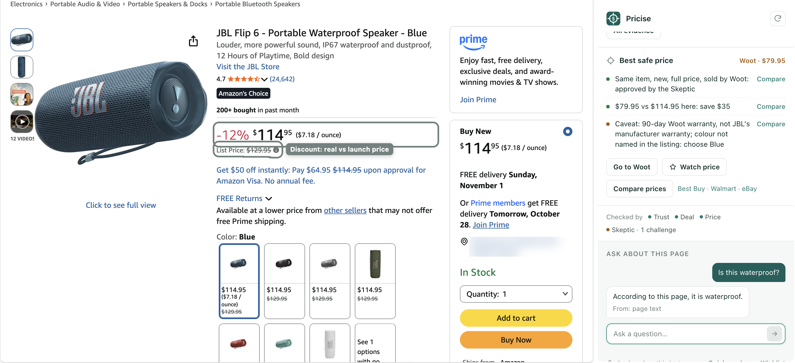
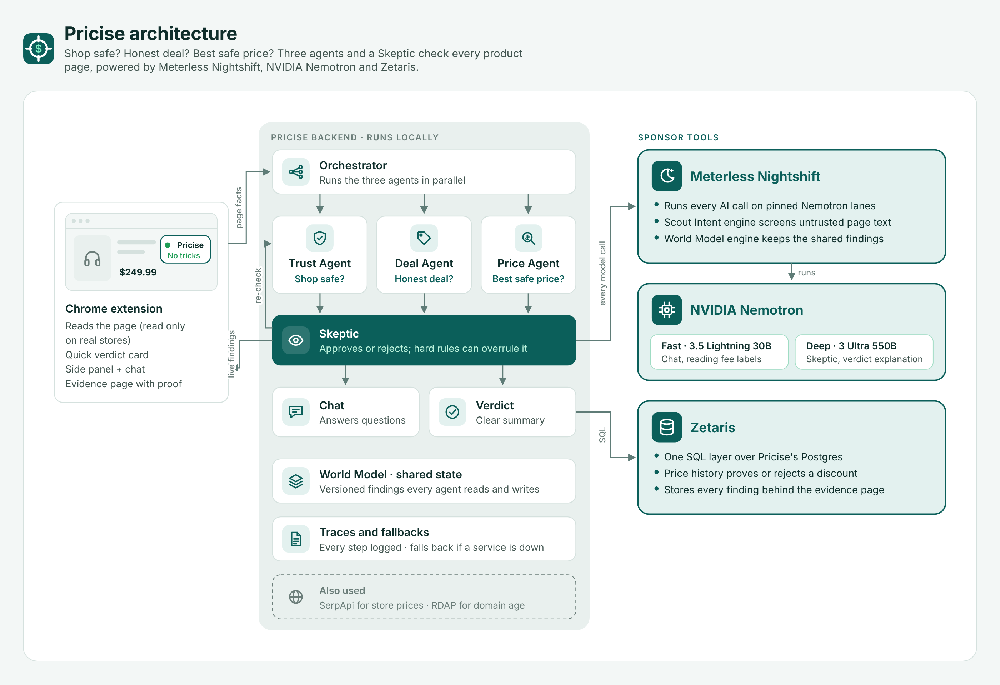
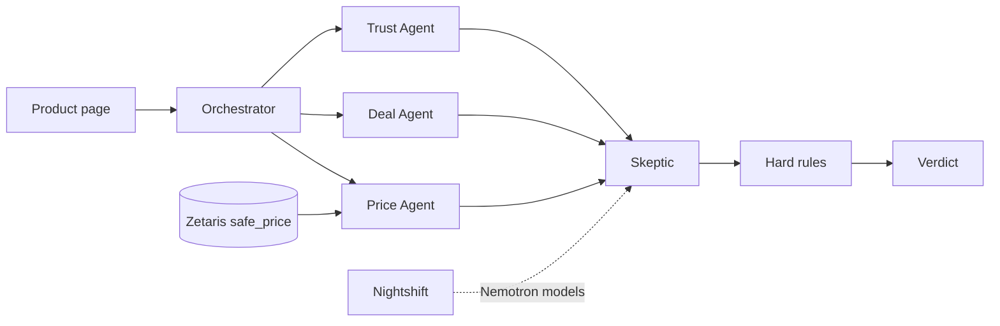
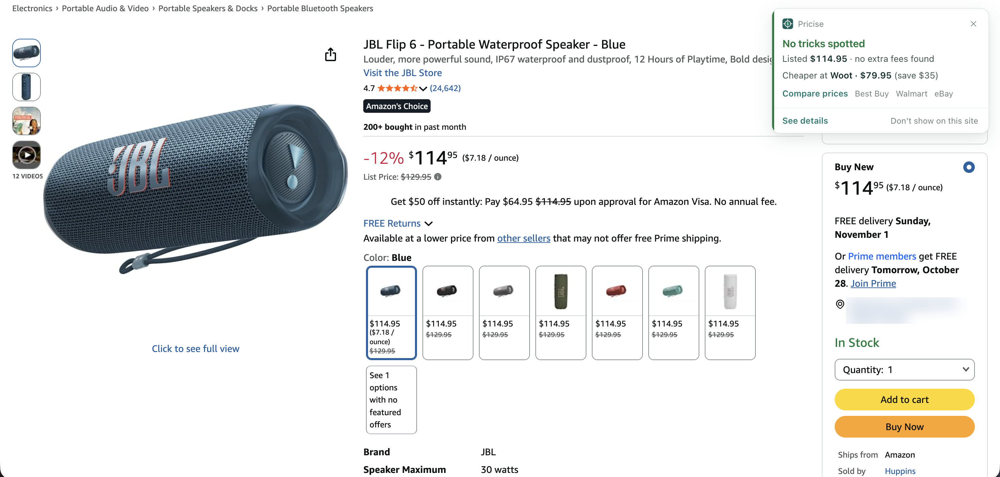
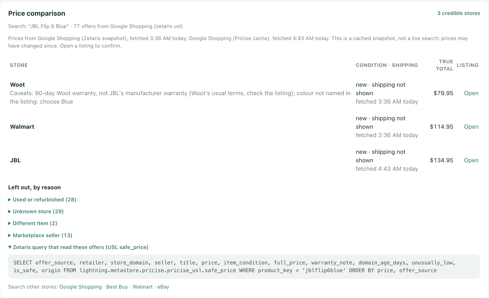
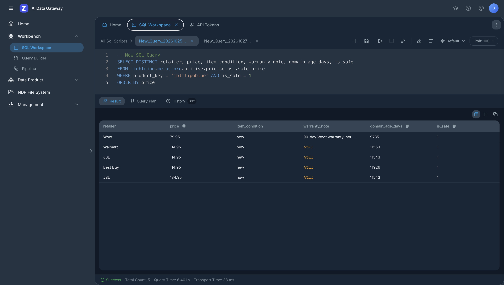
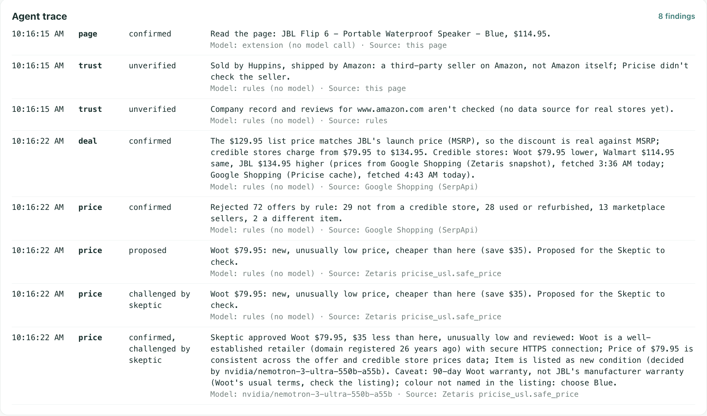

# Pricise

**Shop safe? Honest deal? Best safe price?**



## The problem

What shoppers run into on a product page, just before they click Buy.

- Fake "was" prices make a normal price look like a deal.
- Countdowns restart on every visit to rush you.
- The same item is often cheaper at a store you would trust, and you can't tell at a glance.

## What Pricise does

A Chrome extension that answers three questions on the page you are on, with proof for every claim.

| Shop safe? | Honest deal? | Best safe price? |
|---|---|---|
| Checks HTTPS, domain age, contact and returns links, and who sells the item | Catches fake discounts, resetting timers, pre-ticked add-ons and late fees | Finds the same item, new, at a credible store, after the Skeptic approves it |

On real stores Pricise only reads the page. It never adds to cart or buys, and never loads other stores' sites.

## How it works

Three agents run in parallel, a Skeptic challenges their findings, and hard rules have the last word over any model.





**A real example.** On a JBL Flip 6 at $114.95 on Amazon (list price $129.95), the Price Agent proposed Woot's new offer at
$79.95, save $35, and rejected 72 other offers by rule. The Skeptic's hard rules passed it and Nemotron 3 Ultra 550B
approved it, with the caveat of a 90-day Woot warranty.

**Why the rules come last:** a model can be talked into approving a used or look-alike item; a hard rule can't. If
Nightshift is unavailable, the rules decide and the trace says so.

## Screenshots

The verdict on the page, the proof behind it, the data query and the agents' trace.

<table>
  <tr>
    <td></td>
    <td></td>
  </tr>
  <tr>
    <td align="center">Verdict</td>
    <td align="center">Evidence page</td>
  </tr>
  <tr>
    <td></td>
    <td></td>
  </tr>
  <tr>
    <td align="center">Zetaris query</td>
    <td align="center">Agent trace</td>
  </tr>
</table>

## Tech stack

What each layer runs on.

| Layer | Technology |
|---|---|
| Extension | Chrome Manifest V3, plain HTML, CSS and ES modules, no build step |
| Backend | Python 3.11+, FastAPI, local on port 8787 |
| AI runtime | Meterless Nightshift, the only AI provider ([backend/llm/meterless.py](backend/llm/meterless.py)) |
| Models | NVIDIA Nemotron 3 Ultra 550B (Skeptic), Nemotron 3.5 Lightning 30B (chat) |
| Engines | Meterless Scout Intent (61 tests) and World Model (38 tests) |
| Data | Zetaris USL `pricise_usl` ([SQL](docs/zetaris/pricise_usl.sql), [write-up](docs/zetaris/USL.md)) over Postgres, RDAP and Google Shopping. About 218 lines of Python became 91 lines of SQL plus one rule |
| Data quality | Zetaris rule `new_full_price`, which flagged 79 offers in the latest run |
| Outside data | SerpApi (Google Shopping), RDAP (public domain records) |

## Quick start

Sample mode replays recorded real runs and needs no keys. Live mode runs every agent against the real services.

**Sample mode, from a clean clone** (Python 3.11+ and Git):

```bash
git clone https://github.com/ganeshskr101-net/Pricise.git pricise && cd pricise
scripts/setup.sh
.venv/bin/python run.py
```

You should see `Best safe price   Woot · $79.95`. This replay was recorded before the "cheaper same item" rule, so it says
"No tricks spotted". A live run that finds the same offer shows the amber "Check before you buy".

**Load the extension:** run `scripts/run.sh`, open `chrome://extensions`, turn on Developer mode, choose **Load unpacked**,
and select the `extension/` folder.

**Live mode.** Start Docker, Zetaris and Nightshift (Judge lane: Ultra; Verify lane: Lightning). Then fill in `.env`: set
`SAMPLE_MODE=false` and the `METERLESS_*`, `NEMOTRON_*`, `ZETARIS_*`, `PRICISE_PG_*` and `SERPAPI_KEY` values listed in
[.env.example](.env.example).

```bash
.venv/bin/python scripts/check_zetaris.py                            # Zetaris answers?
docker compose -f docker-compose.pricise.yml --env-file .env up -d   # Pricise Postgres
.venv/bin/python scripts/seed.py                                     # create the tables
.venv/bin/python scripts/register_zetaris.py --yes                   # register Postgres in Zetaris
.venv/bin/python scripts/zetaris_usl.py run 1 22                     # create the sources, the USL and the rule
scripts/run.sh --real                                                # start the live backend
```

## Examples

Three real product pages and one synthetic test store made up by us, each with its agent trace.

Inputs are in [input_examples/](input_examples/) and outputs are in [output_examples/](output_examples/).

## Tests

The offline suite makes no live calls when the keys are blank.

```bash
.venv/bin/python -m pytest -q
```

Result: 700 passed, 5 skipped (the skipped tests need a local Postgres or Zetaris).

## Key terms

The words this README uses, in plain English.

| Term | Meaning |
|---|---|
| Agent | A program that checks one thing and reports findings with proof |
| Skeptic | The agent that challenges other agents' findings and can reject them |
| Orchestrator | Runs the agents at the same time and passes their findings to the Skeptic |
| World Model | A shared, versioned list of findings for one check |
| Scout Intent | Removes instructions hidden in page text before any model reads it |
| Nightshift | Meterless's local runtime; every model call goes through it |
| USL (Unified Semantic Layer) | One table in Zetaris that joins several data sources |
| Data-quality rule | A rule Zetaris checks on every row; it lists the rows that fail |

## Limitations

What to keep in mind when you use Pricise or read its results.

- **Read-only on real stores:** it never adds to cart or buys; its only click is unticking an add-on when you press Untick.
- **Cached prices:** Google Shopping prices come from a snapshot in Zetaris, so they can be hours or days old; pages show when they were fetched.
- **Recorded examples:** results such as the Woot offer may differ from a live run, because prices change.
- **Limited lists:** the MSRP list covers one product (JBL Flip 6), and the trusted-store list covers 20 retailers plus brands' own stores.
- **Live mode needs local services:** Zetaris, Postgres and Meterless Nightshift must be running; sample mode needs none of them.

## Team and License

Who built it, and how you can use it.

Team Hat's Off · ChallengeX: Shriganesh, Abel, Josh, Emmanuel

Slides: [PDF](docs/Pricise-ChallengeX.pdf) · [PowerPoint](docs/Pricise-ChallengeX.pptx)

[MIT License](LICENSE). The vendored Meterless engines keep their own [Apache-2.0 license](backend/engines/world_model_ts/LICENSE).
